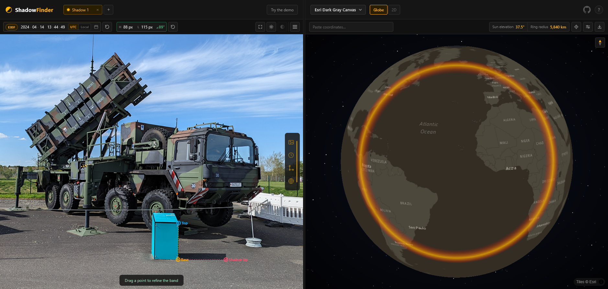
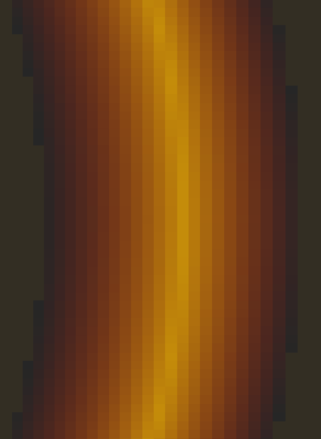
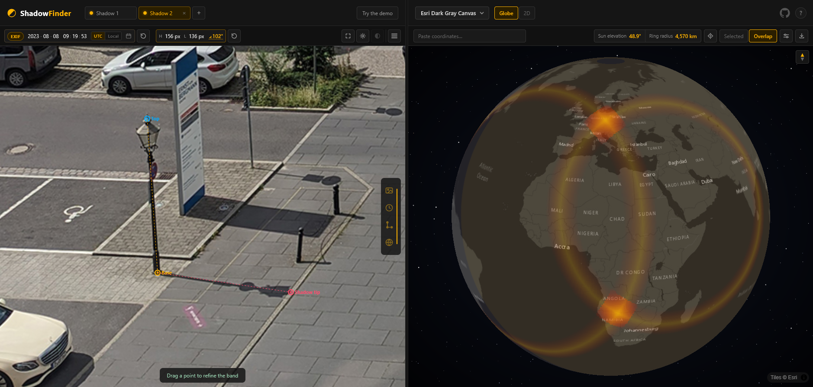

<h1> ShadowFinder <code>Web</code></h1>

**Geolocate a photo by the length of a shadow, entirely in your browser.**

`ShadowFinder Web` is a browser-based port of Bellingcat's [**ShadowFinder**](https://github.com/bellingcat/ShadowFinder). From an object, its shadow, and the date and time, it maps **every place on Earth** where that shadow could fall. Drop a photo, mark three points, and the band appears on a globe. No setup, accounts, Jupyter or Colab. No uploads. No server. Everything runs locally in your browser.

**[Try it live → kluter.github.io/ShadowFinder-Web](https://kluter.github.io/ShadowFinder-Web/)**



---

## Standing on the shoulders of Bellingcat

This project would not exist without the original [ShadowFinder](https://github.com/bellingcat/ShadowFinder), created by [**Galen Reich**](https://github.com/GalenReich) at Bellingcat, with contributors **Jordan Gillard**, **Thomas Ellmenreich** and **Boris Nezlobin**. They did the hard part. `ShadowFinder Web` is a faithful re-implementation of their algorithm in JS.

If you use this tool in research, cite the original project.

---

## What it adds over the notebook

The original is brilliant, but getting a result takes work: a Google sign-in for Colab, measuring shadow pixels in a *separate* tool, and pasting numbers into code cells. `ShadowFinder Web` removes those steps.

| Aspect | Original notebook | `ShadowFinder Web` |
|---|---|---|
| **To start** | Colab and a Google sign-in | open a web page |
| **Measuring** | a separate image tool, then paste numbers | click base, top and shadow tip on the photo |
| **Running it** | edit and run code cells | nothing to run: the band follows every change |
| **Date and time** | type it in | filled in from the photo's `EXIF`, or typed |
| **Bad geometry** | no warning | live shadow-angle warning (experimental) |
| **Result** | a static `PNG` | an interactive **globe** or flat map, on dark, street or satellite base maps |
| **Combining shots** | one shadow, one band | up to three timed shots of the same place; their overlap pins it |
| **Checking a place** | none | paste coordinates to see if they fall in the band; right-click to open the spot in Google Maps, Google Earth, [TracePoint](https://github.com/kluter/TracePoint) and more |
| **Taking it further** | the `PNG` | export to Google Earth (`KMZ`) and GIS (`GeoTIFF`, `GeoJSON`), see [docs/export.md](docs/export.md) |
| **Saving work** | the notebook | session files with optional photos, and autosave in the browser |

---

## The key requirement

> **Shadow length is only accurate when the shadow runs sideways across the frame**, about 90° to the object. Toward or away from the camera, perspective distorts its length and the band lands in the wrong place. The tool measures this angle and warns you: green is reliable, yellow usable, red likely wrong ([thresholds](docs/method.md#the-shadow-angle)).

---

## How to use

1. **Add a photo:** drop it, paste it with `Ctrl+V`, or click *Browse*. Its `EXIF` capture time fills in by itself.
2. **Mark three points:** the base of the object, its top, then the shadow tip. Drag a point to adjust.
3. **Check the time** and pick **UTC** or **Local**. The band appears as soon as the input is complete.
4. **Narrow it down:** **+** adds the same place at another time. Where the bands overlap is the spot.

No photo? Type the object's height **H** and shadow length **L** (any unit, only the ratio matters) and the time.

> New here? Click **Try the demo** and mark the teal box: its base, its top, then the tip of its shadow.

Every control, the accepted coordinate formats and the session file format are in **[docs/controls.md](docs/controls.md)**.

---

## Reading the result



The band is **every place the shadow could fall**, a search space, not a pin.

- **Brightest is the best match**, fading out toward the 20% edge. The colours follow the base map (amber on the dark map, as in the legend; orange-red on OpenStreetMap; magenta-violet on satellite).
- Expect a long curved band, not a dot. A tighter band means better input.
- With two or more shadows, **Overlap** shows every band plus where they all match; **Selected** shows only the current shadow's band. **Layers** sets the opacity of each band, the overlap and the day/night shade.
- It only rules places out. Combine it with terrain, climate and other clues.

How the band is computed, Local time, and the limits of the method: **[docs/method.md](docs/method.md)**.

---

## Try it yourself

#### Three single-shadow cases with known answers

| Test | Date and time | Expected |
|------|---------------|----------|
| Manual input: `H 10`, `L 8` | `2024-02-29 12:00:00 UTC` | The ring from the original's [README](https://github.com/bellingcat/ShadowFinder) |
| A [sunny seaside image](https://www.bellingcat.com/app/uploads/2024/08/image10.jpg) | `2024-07-10 10:30:46 UTC` | Bellingcat's [result map](https://www.bellingcat.com/app/uploads/2024/08/ShadowTool.png) |
| A [still](assets/05_03_2024_111741_shadow_test_rainbolt.png) from this [Rainbolt video](https://www.youtube.com/watch?v=pQIjDPFgdJA) | `2024-05-03 11:17:41 Local` | The [result](assets/result_shadow_test_rainbolt.png) revealed in the video |

Mind the Rainbolt date: the video writes it `05 03 2024`, month first, so that is 3 May, not 5 March.

#### Cross two shadows into an intersection

One shadow gives a band that wraps the globe. The **same place** at two different times gives two bands that cross. Two demo frames of one location, each with its capture time in `EXIF` (in `UTC`):

| Shadow | Photo | Date and time |
|---|---|---|
| 1 | [20230808_091953195.jpg](assets/DEMO_20230808_091953195.jpg) | `2023-08-08 09:19:53 UTC` |
| 2 | [20240414_134449138.jpg](assets/DEMO_20240414_134449138.jpg) | `2024-04-14 13:44:49 UTC` |

Drop the first photo and mark its shadow. Then drop the second (it opens a new shadow by itself, or click **+** first) and mark its shadow. The map turns to the bright zone where the two bands overlap:



<p align="center"><sub>Inspired to implement the intersection by <a href="https://bytemallet.github.io/shadowtrace/">ShadowTrace</a> (bytemallet).</sub></p>

---

## Security & Privacy

- **Your photos never leave your machine.** No request carries image data. Check it in DevTools → Network.
- **The only requests are map tiles** (Esri, OpenStreetMap). They carry no image or session data, but tile coordinates do reveal the area you are looking at.
- **Autosave keeps your shadows and photos in this browser** (`IndexedDB`), never anywhere else. Switch it off in the ☰ menu for sensitive material; **Clear** deletes the saved copy.
- **Right-click links** (Google, Bing, TracePoint and others) contact those sites only when you click one.
- **Imported files cannot run code.** The code is plain, unminified JavaScript with two pinned, bundled libraries ([MapLibre GL JS](https://maplibre.org/), [exifr](https://github.com/MikeKovarik/exifr)); nothing loads from a CDN.

This tool was developed with AI assistance, disclosed because the [risks of opaque, AI-generated OSINT tools](https://www.dutchosintguy.com/post/vibe-coding-is-becoming-an-osint-risk) are real; the answer is readable code anyone can verify.

Every request, every stored value and all caveats: **[docs/privacy.md](docs/privacy.md)**.

---

## Run it locally

A static site, no build step. Serve the folder with anything:

```bash
npx serve .
# or
python3 -m http.server
```

---

## Recognition

`ShadowFinder Web` is listed in **[awesome-osint](https://github.com/jivoi/awesome-osint#-geospatial-research-and-mapping-tools)**, the curated list of open source intelligence tools, under *Geospatial Research and Mapping Tools*.

---

## Related

 **[TracePoint](https://github.com/kluter/TracePoint)** - Geolocate a photo by intersecting lines of sight.

 **[SiliconAperture](https://github.com/kluter/SiliconAperture)** - Measure the real-world size of an object from a single photograph.
